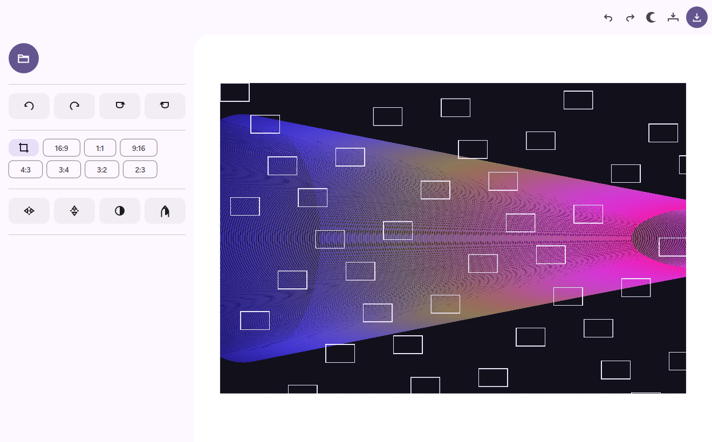

# Fustimage

本地图片编辑器。**C17 + Win32 + Direct2D + DirectWrite + WIC**，界面完全自绘，按 Material Design 3 的规范重写；没有任何网页壳、运行时或第三方 UI 库。



## 这一版改了什么

旧版是「Material You 风格」的自绘界面：单侧栏堆满卡片、双层标题、彩色字节点阵铺满画布、启动时同步建 D3D 硬件设备再显示窗口。
新版按 MD3 的组件、色调与动态规范重建，并把启动路径重排为「先出窗口、再出内容、再补高清」：

| 指标 | 旧版 | 新版 |
| --- | --- | --- |
| 窗口可见 | 277–433 ms | **15–80 ms** |
| 首帧（窗口有内容） | 436–594 ms | **94–280 ms** |
| 载入 6000×4000 JPEG | 同步，界面停住 | 预览 140 ms 先上屏，全尺寸 172 ms 后台替换 |

详细测量方法与数据见 [docs/STARTUP.md](docs/STARTUP.md)，MD3 落地清单见 [docs/MD3.md](docs/MD3.md)。

## 功能

- **打开**：工具栏按钮、`Ctrl+O`、拖放，或 `Fustimage.exe <图片>`。
- **旋转 / 镜像**：左转 90°、右转 90°、左转 180°、右转 180°，水平/垂直翻转；可任意组合。
- **裁剪**：16:9、1:1、9:16、4:3、3:4、3:2、2:3、自由。
  - 任何比例 chip 都会先进入裁剪模式并把选区拟合到该比例；框内拖动平移、8 个手柄改边/改角（按比例锁定），
  `Enter`/✓ 应用、`Esc`/✕ 取消；从框外起笔可以拉一个全新的选区。
  - 应用（✓）/ 取消（✕）放在面板顶部，和第一版一致；`Enter` 应用，`Esc` 取消。
- **滤镜**：黑白（Rec. 709 亮度）、反色；在预乘 BGRA 上就地计算。
- **缩放**：滚轮以光标为中心缩放、拖拽平移、「适应 / 100%」分段按钮。
- **编辑历史**：撤销 / 重做，保存 64 个文档状态（旋转、镜像、裁剪、滤镜一起回退）。
- **导出**：`Ctrl+S` → 系统保存对话框，按扩展名写 PNG / JPEG（质量 0.92）/ BMP / TIFF；带透明通道的图导出 JPEG / BMP 时自动铺白底。写入临时文件后原子替换，不会写坏原图。
- **浅色 / 深色**：同一套语义角色，标题栏交给 DWM 同步；选择记在 `HKCU\Software\Fustimage`。
- **窗口尺寸类**：≥840 dp 用常驻侧栏（340/360 dp），<840 dp 收成工具浮层。
- **一键另存**：顶栏保存左侧的按钮直接把结果写到源文件旁边（`<名字>-edited<扩展名>`），不弹对话框。
- **纯图标界面**：顶栏与侧栏全部是图标按钮（打开、保存、另存到源文件旁、旋转、翻转、滤镜、裁剪比例），
  顶栏不放应用名与徽标，文字只出现在悬停提示与结果提示条里；裁剪比例用数字 chip 表达。
- **点击反馈**：按下控件时从落点扩散一枚圆形水波纹并淡出，绘制被裁到控件自身范围内。
- **一体化的顶栏与侧栏**：两者共用 `surface` 底色、中间没有分界线，画布左上角在交界处切成 28 dp 圆角；
  180° 旋转用 U 形调头箭头表示。

## 快捷键

| 操作 | 快捷键 |
| --- | --- |
| 打开 / 保存 | `Ctrl+O` / `Ctrl+S` |
| 撤销 / 重做 | `Ctrl+Z` / `Ctrl+Y`（或 `Ctrl+Shift+Z`） |
| 适应窗口 / 100% | `Ctrl+F` / `Ctrl+0` |
| 放大 / 缩小 | `Ctrl+=` / `Ctrl+-`（滚轮同效） |
| 右转 / 左转 90° | `R` / `Shift+R` |
| 水平 / 垂直翻转 | `H` / `Shift+H` |
| 深 / 浅色 | `T` |
| 应用 / 取消裁剪 | `Enter` / `Esc` |

## 构建

```powershell
# 需要 MinGW-w64（脚本默认 D:\ruanjian\rust-env\w64devkit\bin）
powershell -ExecutionPolicy Bypass -File .\build.ps1
# 产物：build\Fustimage.exe
```

链接：`d2d1 dwrite windowscodecs dwmapi shcore ole32 oleaut32 uuid shell32 comdlg32 gdi32 user32 propsys`。

## 命令行

```powershell
# 打开图片
.\build\Fustimage.exe "D:\photos\a.jpg"

# 批量导出（无窗口，可脚本化）
.\build\Fustimage.exe --export out.jpg in.jpg --rot=1 --gray --crop=0.1,0.1,0.9,0.9

# 离屏渲染 UI 截图（不建窗口、不抢焦点，用于文档与回归对比）
.\build\Fustimage.exe --shot ui.png in.jpg --dark --crop=1
```

`--export` / `--shot` 共用同一套参数：`--rot=N`、`--mirror-h`、`--mirror-v`、`--gray`、`--invert`、`--crop=l,t,r,b` 或 `--crop=N`（预置索引）；`--shot` 另支持 `--dark`、`--size=WxH`、`--zoom100`、`--cropping`。

## 工程结构

```
src/
  app.h      共享状态与契约（语义色、排版、图标与动作枚举、文档状态）
  theme.c    MD3 亮/暗色角色表 + DirectWrite 排版（9 级）
  icons.c    矢量图标（24×24、2 dp 描边、一次性建几何）
  ui.c       布局、绘制、命中与指针（顶栏 / 侧栏 / 画布 / 裁剪叠加 / 提示条）
  image.c    WIC 解码（含 EXIF 方向、缩放解码）、滤镜、编码导出
  main.c     窗口、消息、工作线程、撤销、文件对话框、命令行
docs/        设计规范与启动测量
bench/       测量与调试工具（启动计时、探针、点击注入、旧版对照）
legacy/      上一版源码（src-v1）与可执行文件
```

## 已知限制

- 只吃本机文件，不做云同步；HEIC/AVIF 取决于系统的 WIC 解码器。
- 大于约 8000 px 的图按 8192 上限解码，超出部分不保留。
- 硬件渲染（D3D）没有启用：本机混合显卡下 `CreateHwndRenderTarget` 要走 250–340 ms 的一次性驱动初始化，代价远大于收益。
