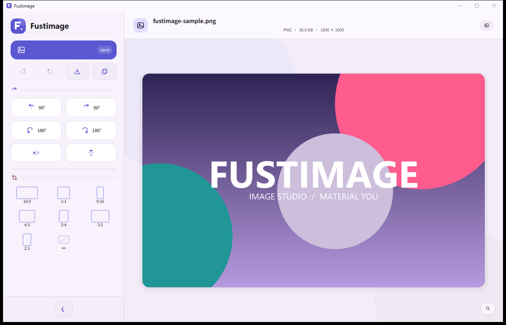

# Fustimage — 图片工坊

一个用 **C17 + Win32 + Direct2D + DirectWrite + WIC** 写的本地快速图片编辑器。界面采用 Material You 风格，全部功能都在左侧工具栏里用自绘 UI 完成，不依赖网页壳或第三方 GUI 库。



## 功能

- **打开**：工具栏按钮、`Ctrl+O`、拖放文件，或启动时把图片路径作为参数。
- **旋转**：左转 90°、右转 90°、左转 180°、右转 180°。旋转卡片只用数字和方向图标表达。
- **镜像**：水平镜像、垂直镜像，可与旋转组合。
- **裁剪**：16:9、1:1、9:16、4:3、3:4、3:2、2:3、自由（∞）。
  - 进入裁剪后可拖动选区移动、拖动边角或边线缩放。
  - 固定比例会保持像素宽高比。
  - `Enter` 应用，`Esc` 取消；工具栏也有纯图标的应用/取消按钮。
- **编辑历史**：撤销、重做；工具栏只显示图标。
- **导出**：按扩展名选择 PNG、JPEG、BMP 或 TIFF。JPEG 质量 0.92；带透明通道的图片导出为 JPEG/BMP 时会铺白底。
  - 导出按钮始终打开系统保存对话框，可自选目录、文件名和格式。
  - 工具栏的“复制”按钮把当前效果直接写到原图旁边，文件名为 `<原名>_copy.<原扩展名>`；重名时自动改用 `_copy-2`、`_copy-3`，不会覆盖原图。
- **自适应布局**：宽、中、紧凑三档。窗口变窄后工具栏收成图标栏，内容可滚动；窗口变矮时裁剪卡片仍可滚动访问。
- **浅色 / 深色**：跟随 Material 语义色，标题栏由 DWM 同步着色。
- **异步载入**：解码在工作线程完成，界面不卡顿。
- **EXIF 方向**：载入时自动应用手机照片的 1–8 方向标记。

所有处理都在本机完成，不上传图片。

## 操作方式

| 操作 | 快捷键 |
| --- | --- |
| 打开图片 | `Ctrl+O` |
| 撤销 / 重做 | `Ctrl+Z` / `Ctrl+Y`（或 `Ctrl+Shift+Z`） |
| 导出 | `Ctrl+S` |
| 右转 / 左转 90° | `R` / `Shift+R` |
| 水平 / 垂直镜像 | `H` / `Shift+H` |
| 切换深色/浅色 | `T` |
| 适应窗口 | `Ctrl+0` 或 `F` |
| 放大 / 缩小 | `Ctrl+=` / `Ctrl+-` |
| 应用裁剪 / 取消裁剪 | `Enter` / `Esc` |

鼠标滚轮在工具栏上滚动；在画布上缩放。画布内拖动可平移，双击恢复适应窗口。

## 构建

需要带 Direct2D、DirectWrite、WIC 头文件和库的 MinGW-w64。当前开发环境使用便携版 w64devkit（GCC 16.2）。

```powershell
cd D:\app edit\Fustimage
powershell -ExecutionPolicy Bypass -File .\build.ps1
```

或直接双击 `build.bat`。脚本优先使用：

```
D:\ruanjian\rust-env\w64devkit\bin
```

找不到时会退回 PATH 里的 `gcc` / `windres`。输出：

```
build\Fustimage.exe
```

手动编译等价命令：

```powershell
gcc -std=c17 -O2 -municode -mwindows `
  -finput-charset=UTF-8 -fexec-charset=UTF-8 -fwide-exec-charset=UTF-16LE `
  src\main.c src\image.c build\app_res.o -o build\Fustimage.exe `
  -ld2d1 -ldwrite -lwindowscodecs -ldwmapi -lshcore `
  -lole32 -loleaut32 -luuid -lshell32 -lcomdlg32 -lgdi32 -luser32 -lpropsys
```

图标和 manifest 由 `src/app.rc` 编入：

```powershell
windres -I src -i src/app.rc -o build/app_res.o
```

## 运行

```powershell
.\build\Fustimage.exe
.\build\Fustimage.exe D:\path\to\photo.jpg
.\build\Fustimage.exe D:\path\to\photo.jpg --dark
```

`--light` 可强制浅色；默认浅色。

## 代码结构

| 文件 | 内容 |
| --- | --- |
| `src/main.c` | 布局、绘制、控件、主题、画布与裁剪覆盖层；末尾 include 两个实现片段 |
| `src/ui_actions.inc` | 编辑动作、历史、裁剪数学、异步载入、打开/保存对话框、导出 |
| `src/ui_window.inc` | WndProc、鼠标/键盘、DPI、窗口创建和消息循环 |
| `src/image.h` / `src/image.c` | WIC 解码、EXIF 方向、旋转/镜像/裁剪后的像素映射与编码 |
| `src/app.rc` / `src/app.manifest` | 图标与 Per-Monitor V2 DPI 声明 |
| `assets/fustimage-icon.png` | 应用图标源图 |

## 设计说明

- 左侧工具栏是唯一的功能入口，全部控件由 Direct2D 自绘，没有原生按钮或图标字体。
- 图形优先：旋转用数字 + 方向图标，镜像、撤销、重做、导出、复制、主题、裁剪应用/取消都用矢量图标；文字只保留在文件名、格式/尺寸元数据、快捷键提示和错误信息等必须精确表达的地方。
- 比例预设默认无底板，只在悬停时出现状态层、选中时显示主色容器和描边；每次选择比例都从当前整张图片重新计算**该比例的最大居中选区**，不会在上一次裁剪范围上继续缩小，快速连续切换也没有间隔限制。
- 语义化 Material You 色板：`primary`、`primary_container`、`surface`、`surface_container_low`、`outline_variant` 等；状态不只靠颜色，还配合选中边框、图标和禁用透明度。
- 裁剪矩形统一保存为“最终显示空间”的归一化坐标 `{left, top, right, bottom}`；旋转/镜像时同步变换裁剪矩形，导出时再做逆变换回原图像素。
- 导出通过临时文件写入，成功后原子替换目标文件，避免半截文件。

## 已知限制

- 自绘控件没有暴露 MSAA/UIA 语义；键盘焦点、Tab 顺序、可见焦点环和 tooltip 可用，但屏幕阅读器无法逐控件朗读。
- 一次只编辑一张图片，没有图层/多文档。
- 裁剪后的画布元数据仍显示源图尺寸；导出文件尺寸以实际裁剪结果为准。
- 主题选择不持久化，下次启动回到浅色（可用 `--dark` 启动）。
